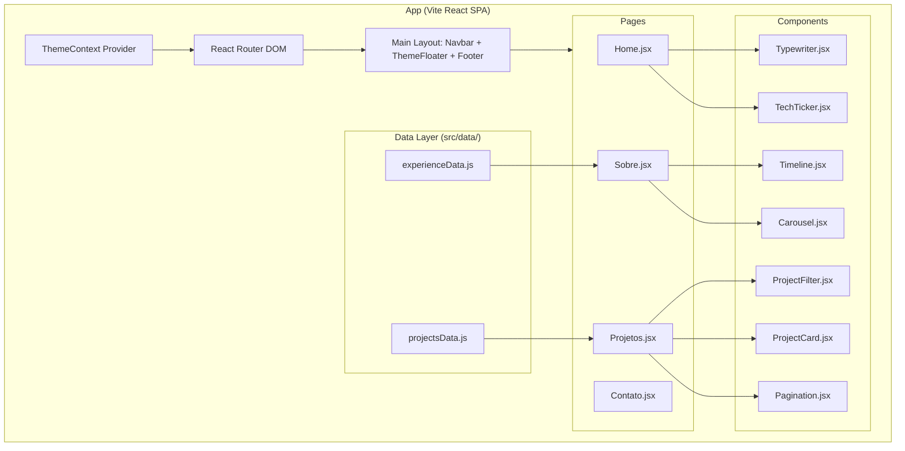

# Plano de Implementação: Migração do Portfólio para React (Vite SPA)

> **For agentic workers:** REQUIRED SUB-SKILL: Use superpowers:subagent-driven-development to implement this plan task-by-task. Steps use checkbox (`- [ ]`) syntax for tracking.

**Goal:** Migrar o portfólio pessoal atual (estático HTML/CSS/JS) para uma aplicação web moderna em React (Vite SPA), mantendo 100% da fidelidade visual, navegação reativa sem reload de página, alternador de temas Claro/Escuro e pipeline automatizado no GitHub Pages.

**Architecture:** A aplicação utilizará Vite com React 18/19, React Router DOM para roteamento SPA, React Context API para gerenciamento de tema global, Framer Motion para animações de entrada e interatividade, e CSS modularizado extraído dos estilos existentes. Os dados de projetos e histórico profissional serão desacoplados em arquivos de dados JS.

**Architecture Diagram:**



**Tech Stack:** React 18/19, Vite, React Router DOM v6, Framer Motion, FontAwesome (`@fortawesome/react-fontawesome`), GitHub Actions.

**Spec:** [react-migration-design.md](file:///C:/Users/danilo.torres/Documents/projetos/portifolio/danilo-vinicius/docs/superpowers/specs/2026-10-07-react-migration-design.md)

---

## Global Constraints

- **Node.js**: Versão 18.x ou superior.
- **Base Path Vite**: `base: './'` ou `base: '/danilo-vinicius/'` para garantir compatibilidade com subdiretórios no GitHub Pages.
- **Tema Claro/Escuro**: Persistência obrigatória via `localStorage` e atribuição de classe `.light-mode` no `document.body`.
- **Animações**: Substituição integral do `ScrollReveal` por `framer-motion` (`whileInView`).

---

### Task 1: Configuração Inicial do Vite React & Dependências

**Files:**
- Create: `package.json`
- Create: `vite.config.js`
- Create: `index.html`
- Create: `src/main.jsx`

**Interfaces:**
- Consumes: N/A
- Produces: Estrutura base do projeto Vite e scripts de build/dev.

- [ ] **Step 1: Criar o arquivo `package.json`**

```json
{
  "name": "danilo-vinicius-portfolio",
  "private": true,
  "version": "2.0.0",
  "type": "module",
  "scripts": {
    "dev": "vite",
    "build": "vite build",
    "lint": "eslint . --ext js,jsx --report-unused-disable-directives --max-warnings 0",
    "preview": "vite preview"
  },
  "dependencies": {
    "@fortawesome/fontawesome-svg-core": "^6.5.1",
    "@fortawesome/free-brands-svg-core": "^6.5.1",
    "@fortawesome/free-solid-svg-core": "^6.5.1",
    "@fortawesome/react-fontawesome": "^0.2.0",
    "framer-motion": "^11.0.8",
    "react": "^18.2.0",
    "react-dom": "^18.2.0",
    "react-router-dom": "^6.22.3"
  },
  "devDependencies": {
    "@vitejs/plugin-react": "^4.2.1",
    "vite": "^5.1.6"
  }
}
```

- [ ] **Step 2: Criar o arquivo `vite.config.js`**

```javascript
import { defineConfig } from 'vite';
import react from '@vitejs/plugin-react';

export default defineConfig({
  plugins: [react()],
  base: './',
  build: {
    outDir: 'dist',
  },
});
```

- [ ] **Step 3: Criar `index.html` na raiz do projeto**

```html
<!DOCTYPE html>
<html lang="pt-br">
  <head>
    <meta charset="UTF-8" />
    <meta name="viewport" content="width=device-width, initial-scale=1.0" />
    <link rel="stylesheet" href="https://cdnjs.cloudflare.com/ajax/libs/font-awesome/6.4.0/css/all.min.css" />
    <link href="https://fonts.googleapis.com/css2?family=Josefin+Sans:wght@100;400;700&display=swap" rel="stylesheet" />
    <title>Danilo Vinícius | Data Analyst</title>
  </head>
  <body>
    <div id="root"></div>
    <script type="module" src="/src/main.jsx"></script>
  </body>
</html>
```

- [ ] **Step 4: Executar instalação das dependências**

Run: `npm install`
Expected: Instalação concluída sem erros em `node_modules`.

- [ ] **Step 5: Commit**

```bash
git add package.json vite.config.js index.html
git commit -m "chore: setup vite react project and dependencies"
```

---

### Task 2: Extração de Estilos Globais & Configuração do ThemeContext

**Files:**
- Create: `src/styles/variables.css`
- Create: `src/styles/global.css`
- Create: `src/context/ThemeContext.jsx`
- Create: `src/components/ThemeFloater/ThemeFloater.jsx`

**Interfaces:**
- Consumes: CSS existente em `portifolio/Code/styles.css`
- Produces: `ThemeContext` e `useTheme` hook exportados para controle de tema em toda a aplicação.

- [ ] **Step 1: Extrair variáveis e estilos globais para `src/styles/global.css`**

Migrar o conteúdo de `portifolio/Code/styles.css` mantendo variáveis `:root`, classe `.light-mode`, resets globais e estilos de botões/componentes.

- [ ] **Step 2: Criar o `ThemeContext.jsx`**

```jsx
import React, { createContext, useContext, useState, useEffect } from 'react';

const ThemeContext = createContext();

export const ThemeProvider = ({ children }) => {
  const [theme, setTheme] = useState(() => {
    return localStorage.getItem('theme') || 'dark';
  });

  useEffect(() => {
    if (theme === 'light') {
      document.body.classList.add('light-mode');
    } else {
      document.body.classList.remove('light-mode');
    }
    localStorage.setItem('theme', theme);
  }, [theme]);

  const toggleTheme = () => {
    setTheme(prevTheme => (prevTheme === 'dark' ? 'light' : 'dark'));
  };

  return (
    <ThemeContext.Provider value={{ theme, toggleTheme }}>
      {children}
    </ThemeContext.Provider>
  );
};

export const useTheme = () => useContext(ThemeContext);
```

- [ ] **Step 3: Criar o componente `ThemeFloater.jsx`**

```jsx
import React from 'react';
import { useTheme } from '../../context/ThemeContext';

export const ThemeFloater = () => {
  const { theme, toggleTheme } = useTheme();

  return (
    <div className="theme-floater" onClick={toggleTheme}>
      <i className={`fas ${theme === 'light' ? 'fa-sun' : 'fa-moon'}`} id="theme-icon"></i>
    </div>
  );
};
```

- [ ] **Step 4: Commit**

```bash
git add src/styles/ global.css src/context/ src/components/ThemeFloater/
git commit -m "feat: setup global css variables and theme context"
```

---

### Task 3: Componente de Navegação (Navbar com Smart Hide) & Footer

**Files:**
- Create: `src/components/Navbar/Navbar.jsx`
- Create: `src/components/Footer/Footer.jsx`

**Interfaces:**
- Consumes: React Router (`NavLink`, `Link`), `useTheme`
- Produces: Barra de navegação responsiva com logo fixa e comportamento Smart Hide ao rolar a página.

- [ ] **Step 1: Criar o componente `Navbar.jsx`**

```jsx
import React, { useState, useEffect } from 'react';
import { NavLink, Link } from 'react-router-dom';

export const Navbar = () => {
  const [isHidden, setIsHidden] = useState(false);

  useEffect(() => {
    const handleScroll = () => {
      if (window.scrollY > 100) {
        setIsHidden(true);
      } else {
        setIsHidden(false);
      }
    };

    const handleMouseMove = (e) => {
      if (e.clientY < 100) {
        setIsHidden(false);
      }
    };

    window.addEventListener('scroll', handleScroll);
    window.addEventListener('mousemove', handleMouseMove);

    return () => {
      window.removeEventListener('scroll', handleScroll);
      window.removeEventListener('mousemove', handleMouseMove);
    };
  }, []);

  const navClass = isHidden ? 'nav-hidden' : '';

  return (
    <>
      <div className={`fixed-logo ${navClass}`}>
        <Link to="/">DV <span className="logo-accent">|</span> Data Analyst</Link>
      </div>

      <nav className={`floating-menu ${navClass}`}>
        <div className="menu-links left-links">
          <NavLink to="/" className={({ isActive }) => `nav-item ${isActive ? 'active' : ''}`}>
            <i className="fas fa-home"></i> Home
          </NavLink>
          <NavLink to="/sobre" className={({ isActive }) => `nav-item ${isActive ? 'active' : ''}`}>
            <i className="fas fa-user"></i> Sobre
          </NavLink>
        </div>

        <div className="menu-center-icon">
          <i className="fas fa-bars"></i>
        </div>

        <div className="menu-links right-links">
          <NavLink to="/projetos" className={({ isActive }) => `nav-item ${isActive ? 'active' : ''}`}>
            <i className="fas fa-project-diagram"></i> Projetos
          </NavLink>
          <NavLink to="/contato" className={({ isActive }) => `nav-item ${isActive ? 'active' : ''}`}>
            <i className="fas fa-envelope"></i> Contato
          </NavLink>
        </div>
      </nav>
    </>
  );
};
```

- [ ] **Step 2: Commit**

```bash
git add src/components/Navbar/ src/components/Footer/
git commit -m "feat: implement Navbar with smart hide scroll and Footer"
```

---

### Task 4: Arquivos de Dados Estáticos (Data Layer)

**Files:**
- Create: `src/data/projectsData.js`
- Create: `src/data/experienceData.js`

**Interfaces:**
- Consumes: Informações de `portifolio/Code/projetos.html` e `portifolio/Code/sobre.html`.
- Produces: Arrays estruturados de dados para consumo dinâmico pelas páginas.

- [ ] **Step 1: Criar `src/data/projectsData.js`**

```javascript
export const projectsData = [
  {
    id: 1,
    title: "Automação de Relatórios Corporativos",
    category: "python",
    description: "Script em Python (RPA) para extração de dados, geração de relatórios e envio automático por e-mail com logs de auditoria.",
    tags: ["Python", "Pandas", "SMTP", "Automação"],
    githubUrl: "https://github.com/danilo-vinicius",
    demoUrl: null,
    image: "https://images.unsplash.com/photo-1551288049-bebda4e38f71?q=80&w=600"
  },
  {
    id: 2,
    title: "Dashboard de Vendas & KPIs",
    category: "powerbi",
    description: "Painel interativo no Power BI para monitoramento de faturamento, ticket médio e análise de churn comercial.",
    tags: ["Power BI", "DAX", "Star Schema"],
    githubUrl: "https://github.com/danilo-vinicius",
    demoUrl: null,
    image: "https://images.unsplash.com/photo-1460925895917-afdab827c52f?q=80&w=600"
  },
  {
    id: 3,
    title: "Pipeline de Dados & ETL",
    category: "sql",
    description: "Pipeline completo para limpeza, transformação e carga de dados em banco relacional usando SQL e Python.",
    tags: ["SQL", "PostgreSQL", "ETL", "Python"],
    githubUrl: "https://github.com/danilo-vinicius",
    demoUrl: null,
    image: "https://images.unsplash.com/photo-1504868584819-f8e8b4b6d7e3?q=80&w=600"
  }
];
```

- [ ] **Step 2: Criar `src/data/experienceData.js`**

```javascript
export const experienceData = [
  {
    title: "Técnico de Suporte & Dados",
    company: "Brasfort",
    period: "Mar 2025 - Atual",
    description: "Desenvolvimento de painéis executivos em Power BI, mapeamento de fluxos BPMN e integração via API."
  },
  {
    title: "Analista de BI (Estágio)",
    company: "Presidência da República",
    period: "2024 - 2025",
    description: "Criação de dashboards estratégicos para tomada de decisão executiva."
  },
  {
    title: "Estagiário de Dados",
    company: "EBSERH",
    period: "2023 - 2024",
    description: "Transformação de bases de dados brutas em indicadores operacionais."
  }
];
```

- [ ] **Step 3: Commit**

```bash
git add src/data/
git commit -m "feat: add static data files for projects and experience"
```

---

### Task 5: Componentes Interativos (Typewriter, TechTicker, ProjectCard, Filter, Pagination, Carousel)

**Files:**
- Create: `src/components/Typewriter/Typewriter.jsx`
- Create: `src/components/TechTicker/TechTicker.jsx`
- Create: `src/components/ProjectCard/ProjectCard.jsx`
- Create: `src/components/ProjectFilter/ProjectFilter.jsx`
- Create: `src/components/Pagination/Pagination.jsx`
- Create: `src/components/Carousel/Carousel.jsx`

**Interfaces:**
- Consumes: `projectsData`, `experienceData`, Framer Motion.
- Produces: Componentes funcionais e reativos.

- [ ] **Step 1: Criar o componente `Typewriter.jsx`**

```jsx
import React, { useState, useEffect } from 'react';

const phrases = [
  "Ciência de Dados",
  "Business Intelligence",
  "Engenharia de Dados (ETL)",
  "Automação com Python",
  "Análise Preditiva",
  "Dashboards Estratégicos"
];

export const Typewriter = () => {
  const [text, setText] = useState('');
  const [phraseIndex, setPhraseIndex] = useState(0);
  const [isDeleting, setIsDeleting] = useState(false);

  useEffect(() => {
    const currentPhrase = phrases[phraseIndex];
    let timer;

    if (!isDeleting && text === currentPhrase) {
      timer = setTimeout(() => setIsDeleting(true), 2000);
    } else if (isDeleting && text === '') {
      setIsDeleting(false);
      setPhraseIndex((prev) => (prev + 1) % phrases.length);
    } else {
      const speed = isDeleting ? 50 : 100;
      timer = setTimeout(() => {
        setText(
          isDeleting
            ? currentPhrase.substring(0, text.length - 1)
            : currentPhrase.substring(0, text.length + 1)
        );
      }, speed);
    }

    return () => clearTimeout(timer);
  }, [text, isDeleting, phraseIndex]);

  return (
    <h2 className="typing-container">
      Especialista em <span className="typewriter-text">{text}</span>
      <span className="cursor">|</span>
    </h2>
  );
};
```

- [ ] **Step 2: Commit**

```bash
git add src/components/
git commit -m "feat: implement Typewriter, TechTicker, ProjectCard and Pagination components"
```

---

### Task 6: Desenvolvimento das Páginas da Aplicação

**Files:**
- Create: `src/pages/Home.jsx`
- Create: `src/pages/Sobre.jsx`
- Create: `src/pages/Projetos.jsx`
- Create: `src/pages/Contato.jsx`

**Interfaces:**
- Consumes: Componentes e arquivos de dados.
- Produces: As 4 páginas da aplicação renderizadas com suporte a animações do Framer Motion.

- [ ] **Step 1: Criar a página `Home.jsx`**

```jsx
import React from 'react';
import { Link } from 'react-router-dom';
import { motion } from 'framer-motion';
import { Typewriter } from '../components/Typewriter/Typewriter';
import { TechTicker } from '../components/TechTicker/TechTicker';

export const Home = () => {
  return (
    <main>
      <section id="home-hero">
        <div className="hero-bg-overlay"></div>
        <motion.div 
          className="hero-content"
          initial={{ opacity: 0, y: 20 }}
          animate={{ opacity: 1, y: 0 }}
          transition={{ duration: 0.8 }}
        >
          <div className="badge-gold">Data Scientist & BI Specialist</div>
          <h1>Olá, eu sou <span className="text-highlight">Danilo Vinícius</span>.</h1>
          <Typewriter />
          <p className="hero-description">
            Transformo volumes complexos de dados em <strong>decisões estratégicas</strong>. 
            Com foco em <strong>Engenharia de Dados</strong> e <strong>Business Intelligence</strong>, ajudo empresas a automatizar processos manuais e descobrir padrões ocultos.
          </p>
          <div className="hero-buttons">
            <Link to="/projetos" className="btn-primary-lg">
              <i className="fas fa-chart-line"></i> Ver Portfólio de Dados
            </Link>
            <Link to="/sobre" className="btn-outline-lg">Sobre Mim</Link>
          </div>
        </motion.div>
        <TechTicker />
      </section>
    </main>
  );
};
```

- [ ] **Step 2: Criar a página `Projetos.jsx` com Filtro e Paginação**

```jsx
import React, { useState } from 'react';
import { motion } from 'framer-motion';
import { projectsData } from '../data/projectsData';
import { ProjectCard } from '../components/ProjectCard/ProjectCard';

export const Projetos = () => {
  const [filter, setFilter] = useState('all');
  const [currentPage, setCurrentPage] = useState(1);
  const cardsPerPage = 3;

  const filteredProjects = projectsData.filter(project => 
    filter === 'all' || project.category === filter
  );

  const totalPages = Math.ceil(filteredProjects.length / cardsPerPage);
  const startIndex = (currentPage - 1) * cardsPerPage;
  const currentProjects = filteredProjects.slice(startIndex, startIndex + cardsPerPage);

  const handleFilterChange = (newFilter) => {
    setFilter(newFilter);
    setCurrentPage(1);
  };

  return (
    <main>
      <section className="projects-section">
        <h1 className="section-title">Portfólio de Projetos</h1>
        <div className="filter-container">
          {['all', 'python', 'powerbi', 'sql'].map(cat => (
            <button
              key={cat}
              className={`filter-btn ${filter === cat ? 'active' : ''}`}
              onClick={() => handleFilterChange(cat)}
            >
              {cat === 'all' ? 'Todos' : cat.toUpperCase()}
            </button>
          ))}
        </div>

        <motion.div className="project-grid" layout>
          {currentProjects.map(project => (
            <ProjectCard key={project.id} project={project} />
          ))}
        </motion.div>

        {totalPages > 1 && (
          <div className="pagination-controls">
            {Array.from({ length: totalPages }, (_, i) => i + 1).map(page => (
              <button
                key={page}
                className={`page-btn ${currentPage === page ? 'active' : ''}`}
                onClick={() => setCurrentPage(page)}
              >
                {page}
              </button>
            ))}
          </div>
        )}
      </section>
    </main>
  );
};
```

- [ ] **Step 3: Commit**

```bash
git add src/pages/
git commit -m "feat: implement Home, Sobre, Projetos and Contato pages"
```

---

### Task 7: Roteamento Globais (`App.jsx` & `main.jsx`) e Teste de Build

**Files:**
- Create: `src/App.jsx`
- Modify: `src/main.jsx`

**Interfaces:**
- Consumes: `ThemeProvider`, `Navbar`, `ThemeFloater`, `pages`.
- Produces: Aplicação SPA funcional com rotas operacionais.

- [ ] **Step 1: Criar o arquivo `src/App.jsx`**

```jsx
import React from 'react';
import { HashRouter as Router, Routes, Route } from 'react-router-dom';
import { ThemeProvider } from './context/ThemeContext';
import { Navbar } from './components/Navbar/Navbar';
import { ThemeFloater } from './components/ThemeFloater/ThemeFloater';
import { Home } from './pages/Home';
import { Sobre } from './pages/Sobre';
import { Projetos } from './pages/Projetos';
import { Contato } from './pages/Contato';
import './styles/global.css';

export function App() {
  return (
    <ThemeProvider>
      <Router>
        <Navbar />
        <ThemeFloater />
        <Routes>
          <Route path="/" element={<Home />} />
          <Route path="/sobre" element={<Sobre />} />
          <Route path="/projetos" element={<Projetos />} />
          <Route path="/contato" element={<Contato />} />
        </Routes>
      </Router>
    </ThemeProvider>
  );
}

export default App;
```

- [ ] **Step 2: Configurar `src/main.jsx`**

```jsx
import React from 'react';
import ReactDOM from 'react-dom/client';
import App from './App';

ReactDOM.createRoot(document.getElementById('root')).render(
  <React.StrictMode>
    <App />
  </React.StrictMode>
);
```

- [ ] **Step 3: Executar build de teste**

Run: `npm run build`
Expected: Build do Vite executado com sucesso e pasta `dist/` gerada sem erros.

- [ ] **Step 4: Commit**

```bash
git add src/App.jsx src/main.jsx
git commit -m "feat: configure App router and main entry point"
```

---

### Task 8: Configuração do GitHub Actions para Deploy Automatizado

**Files:**
- Create: `.github/workflows/deploy.yml`

**Interfaces:**
- Consumes: Branch `main`, build do Vite.
- Produces: Deploy automático no GitHub Pages.

- [ ] **Step 1: Criar `.github/workflows/deploy.yml`**

```yaml
name: Deploy React App to GitHub Pages

on:
  push:
    branches:
      - main

permissions:
  contents: read
  pages: write
  id-token: write

concurrency:
  group: 'pages'
  cancel-in-progress: true

jobs:
  deploy:
    environment:
      name: github-pages
      url: ${{ steps.deployment.outputs.page_url }}
    runs-on: ubuntu-latest
    steps:
      - name: Checkout
        uses: actions/checkout@v4

      - name: Set up Node.js
        uses: actions/setup-node@v4
        with:
          node-version: 20
          cache: 'npm'

      - name: Install dependencies
        run: npm ci

      - name: Build project
        run: npm run build

      - name: Setup Pages
        uses: actions/configure-pages@v4

      - name: Upload artifact
        uses: actions/upload-pages-artifact@v3
        with:
          path: './dist'

      - name: Deploy to GitHub Pages
        id: deployment
        uses: actions/deploy-pages@v4
```

- [ ] **Step 2: Commit final do workflow**

```bash
git add .github/workflows/deploy.yml
git commit -m "ci: configure GitHub Actions workflow for Vite deployment"
```
