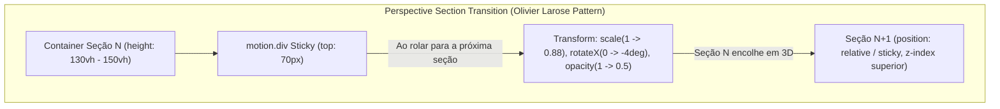

# Olivier Larose Perspective Section Transition Implementation Plan

> **For agentic workers:** REQUIRED SUB-SKILL: Use superpowers:subagent-driven-development to implement this plan task-by-task. Steps use checkbox (`- [ ]`) syntax for tracking.

**Goal:** Implementar o efeito exato **Perspective Section Transition** do Olivier Larose na página `Sobre.jsx`, onde a seção que está sendo coberta encolhe em 3D (`scale: 1 -> 0.88`, `rotateX: 0 -> -4deg`, `opacity: 1 -> 0.5`) enquanto a próxima seção sobe por cima dela no scroll.

**Architecture:** Criar um componente reutilizável `PerspectiveSection` (ou wrapper de camada) utilizando Framer Motion (`useScroll`, `useTransform`). Cada seção terá um container com altura estendida e uma camada `motion.div` com `position: sticky`, `perspective: 1200px` e `transformOrigin: top center`.

**Architecture Diagram:**



---

### Task 1: Criar o Componente PerspectiveSection / Wrapper 3D

**Files:**
- Create: `src/components/PerspectiveSection/PerspectiveSection.jsx`
- Create: `src/components/PerspectiveSection/PerspectiveSection.css`

**Interfaces:**
- Props: `children`, `index`, `total`, `stickyTop` (default: 70).
- Produces: Um container com `useScroll` que transforma `scale` (1 -> 0.88), `rotateX` (0 -> -4deg) e `opacity` (1 -> 0.5) conforme a rolagem avança para a seção seguinte.

- [ ] **Step 1: Criar PerspectiveSection.jsx**

```jsx
import React, { useRef } from 'react';
import { motion, useScroll, useTransform } from 'framer-motion';
import './PerspectiveSection.css';

export function PerspectiveSection({
  children,
  index,
  total,
  stickyTop = 70,
  className = '',
  id
}) {
  const containerRef = useRef(null);

  const { scrollYProgress } = useScroll({
    target: containerRef,
    offset: ['start start', 'end start']
  });

  // Para todas as seções exceto a última, encolher e inclinar em perspectiva 3D quando a próxima seção subir
  const isLast = index === total - 1;
  const scale = useTransform(scrollYProgress, [0, 1], isLast ? [1, 1] : [1, 0.88]);
  const rotateX = useTransform(scrollYProgress, [0, 1], isLast ? [0, 0] : [0, -4]);
  const opacity = useTransform(scrollYProgress, [0, 1], isLast ? [1, 1] : [1, 0.4]);

  return (
    <div
      ref={containerRef}
      id={id}
      className={`perspective-section-wrapper ${className}`}
      style={{
        position: 'relative',
        minHeight: isLast ? 'auto' : '130vh',
        zIndex: (index + 1) * 10
      }}
    >
      <motion.div
        className="perspective-section-card"
        style={{
          position: isLast ? 'relative' : 'sticky',
          top: isLast ? 'auto' : `${stickyTop}px`,
          scale,
          rotateX,
          opacity,
          transformOrigin: 'top center',
          perspective: '1200px'
        }}
      >
        {children}
      </motion.div>
    </div>
  );
}

export default PerspectiveSection;
```

- [ ] **Step 2: Criar PerspectiveSection.css**

Estilizar o cartão da seção com fundo `--bg-primary` (ou `--bg-surface`), bordas superiores arredondadas (`24px 24px 0 0`), borda sutil e sombra de elevação 3D.

---

### Task 2: Integrar o PerspectiveSection na Página Sobre.jsx

**Files:**
- Modify: `src/pages/Sobre.jsx:1-196`
- Modify: `src/pages/Sobre.css:1-100`

**Interfaces:**
- Substituir as divs `.sobre-stacked-section` pelos componentes `<PerspectiveSection index={...} total={4}>`.

- [ ] **Step 1: Atualizar Sobre.jsx**
Envelopar as 4 seções principais com o novo `<PerspectiveSection>`:
1. `secao-1-apresentacao` (index 0)
2. `secao-2-experiencia` (index 1)
3. `secao-3-formacao` (index 2)
4. `secao-4-especialidades` (index 3)

- [ ] **Step 2: Ajustar Sobre.css**
Ajustar estilos de fundo e espaçamentos internos para garantir encaixe perfeito do efeito 3D.

---

### Task 3: Validação do Build e Grafo

**Files:**
- Run `npm run build`
- Run `graphify update .`

- [ ] **Step 1: Executar build de verificação**
Executar `npm run build` para testar se Framer Motion e estilos compilam sem erros.

- [ ] **Step 2: Atualizar Graphify**
Executar `graphify update .` para sincronizar o grafo do projeto.
