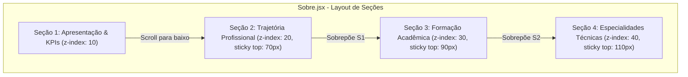

# Section Overlap Scroll Effect Implementation Plan (Sobre Page)

> **For agentic workers:** REQUIRED SUB-SKILL: Use superpowers:subagent-driven-development to implement this plan task-by-task. Steps use checkbox (`- [ ]`) syntax for tracking.

**Goal:** Substituir as transições antigas da página `Sobre.jsx` por um efeito de sobreposição de seções (Stacked Section Overlap) ao rolar a página, no qual cada seção sobe e se sobrepõe à seção anterior com bordas arredondadas e sombra de profundidade.

**Architecture:** A estrutura de seções da página `Sobre.jsx` será atualizada removendo o `SectionFlow` e `MagneticPull`. O CSS da página `Sobre.css` receberá a estilização de *sticky card stacking* (`position: sticky; top: offset; z-index: N; background: var(--bg-primary); border-radius: 24px 24px 0 0; box-shadow: 0 -15px 40px ...`), criando a sobreposição fluida à medida que a página é rolada para baixo.

**Architecture Diagram:**



---

### Task 1: Refatoração da Estrutura de Seções em Sobre.jsx

**Files:**
- Modify: `src/pages/Sobre.jsx:1-196`

**Interfaces:**
- Remove wrappers `SectionFlow`, `Section` (legado) e `MagneticPullSection`.
- Mantém o overlay 3D do Lanyard no topo e estrutura as 4 seções principais com classe `.sobre-stacked-section` e IDs correspondentes.

- [ ] **Step 1: Atualizar os imports e estrutura em Sobre.jsx**
Remover os componentes legados de transição (`SectionFlow`, `Section`, `MagneticPullSection`, `MagneticPull`) e envelopar as 4 seções principais com a classe `.sobre-stacked-section`.

- [ ] **Step 2: Ajustar a hierarquia das seções**
Garantir que cada seção possua o seu ID descritivo e uma classe de camada correspondente (`section-layer-1`, `section-layer-2`, `section-layer-3`, `section-layer-4`).

---

### Task 2: Implementação do Efeito CSS de Sobreposição (Sticky Card Stacking)

**Files:**
- Modify: `src/pages/Sobre.css:1-347`

**Interfaces:**
- Aplica `position: sticky; top: ...; z-index: ...` com bordas superiores arredondadas (`border-radius: 24px 24px 0 0`), sombra de elevação superior (`box-shadow: 0 -15px 40px rgba(0, 0, 0, 0.45)`) e fundo sólido (`var(--bg-primary)`) para que a seção que sobe cubra totalmente a anterior.

- [ ] **Step 1: Adicionar estilos de sobreposição sticky em Sobre.css**
Definir as propriedades de empilhamento:
```css
.sobre-stacked-section {
    position: sticky;
    background-color: var(--bg-primary);
    border-top: 1px solid var(--border-color);
    border-radius: 24px 24px 0 0;
    box-shadow: 0 -15px 40px rgba(0, 0, 0, 0.45);
    margin-bottom: 60px;
    padding: 60px 40px;
    transition: transform 0.3s ease, box-shadow 0.3s ease;
}

body.light-mode .sobre-stacked-section {
    box-shadow: 0 -8px 30px rgba(0, 0, 0, 0.08);
}

.section-layer-1 {
    position: relative;
    z-index: 10;
    border-top: none;
    border-radius: 0;
    box-shadow: none;
}

.section-layer-2 {
    top: 70px;
    z-index: 20;
}

.section-layer-3 {
    top: 90px;
    z-index: 30;
}

.section-layer-4 {
    top: 110px;
    z-index: 40;
}
```

- [ ] **Step 2: Ajustar a responsividade mobile**
Garantir que em dispositivos móveis (`max-width: 768px`) o padding e o offset `top` fiquem ajustados (`top: 60px`), mantendo a experiência fluida sem cortes.

---

### Task 3: Validação do Build e Grafo

**Files:**
- Run `npm run build`
- Run `graphify update .`

- [ ] **Step 1: Testar compilação**
Executar `npm run build` para garantir zero erros de sintaxe ou dependências quebradas.

- [ ] **Step 2: Atualizar a base do Graphify**
Executar `graphify update .` para manter a base de conhecimento sincronizada.
