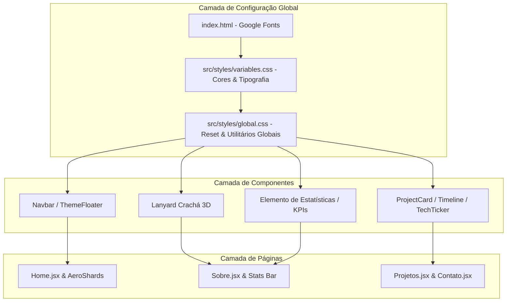

# Nova Identidade Visual e Tipografia Implementation Plan

> **For agentic workers:** REQUIRED SUB-SKILL: Use superpowers:subagent-driven-development to implement this plan task-by-task. Steps use checkbox (`- [ ]`) syntax for tracking.

**Goal:** Atualizar todo o portfólio para a nova identidade visual moderna e de alto contraste, utilizando o esquema de cores Slate/Sky/Indigo e o par de fontes Plus Jakarta Sans, JetBrains Mono e Inter.

**Architecture:** A reformulação visual será estruturada a partir das variáveis globais CSS em `src/styles/variables.css` e regras globais em `src/styles/global.css`, com importação das fontes Google Fonts em `index.html`. Em seguida, as atualizações serão refletidas nos componentes base (Navbar, Footer, ThemeFloater, TechTicker, Lanyard, ProjectCard, Timeline) e nas páginas da aplicação (`Home.jsx`, `Sobre.jsx`, `Projetos.jsx`, `Contato.jsx`).

**Architecture Diagram:**



**Tech Stack:** React, Vite, CSS Variables, Framer Motion, Three.js / OGL (AeroShards e Lanyard).

---

### Task 1: Configuração das Fontes Google Fonts e Variáveis Globais CSS

**Files:**
- Modify: `index.html:1-15`
- Modify: `src/styles/variables.css:1-52`
- Modify: `src/styles/global.css:1-82`

**Interfaces:**
- Consumes: Google Fonts API (`Plus Jakarta Sans`, `JetBrains Mono`, `Inter`)
- Produces: CSS Variables `--bg-primary`, `--bg-surface`, `--text-primary`, `--text-secondary`, `--accent-primary`, `--accent-secondary`, e variáveis de tipografia `--font-title`, `--font-mono`, `--font-body`.

- [ ] **Step 1: Importar Google Fonts em index.html**

Atualizar o arquivo `index.html` substituindo a fonte legada `Josefin Sans` pelas novas famílias de fontes:
- `Plus Jakarta Sans` (700, 800)
- `JetBrains Mono` (500, 600, 700)
- `Inter` (400, 500, 600, 700)

```html
<link rel="preconnect" href="https://fonts.googleapis.com">
<link rel="preconnect" href="https://fonts.gstatic.com" crossorigin>
<link href="https://fonts.googleapis.com/css2?family=Inter:wght@400;500;600;700&family=JetBrains+Mono:wght@500;600;700&family=Plus+Jakarta+Sans:wght@700;800&display=swap" rel="stylesheet" />
```

- [ ] **Step 2: Atualizar variáveis em src/styles/variables.css**

Definir as variáveis nos modos escuro (padrão) e claro:

```css
:root {
    /* --- TEMA ESCURO (PADRÃO) --- */
    --bg-primary: #0F172A;        /* Slate 900 */
    --bg-surface: #1E293B;        /* Slate 800 */
    --text-primary: #F8FAFC;      /* Slate 50 */
    --text-secondary: #94A3B8;    /* Slate 400 */
    --accent-primary: #38BDF8;    /* Sky 400 */
    --accent-secondary: #6366F1;  /* Indigo 500 */

    /* Compatibilidade para variáveis legadas */
    --bg-gradient: var(--bg-primary);
    --bg-solid: var(--bg-primary);
    --bg-card: var(--bg-surface);
    --bg-card-hover: #273549;
    --text-title: var(--text-primary);
    --accent-color: var(--accent-primary);
    --nav-bg: rgba(15, 23, 42, 0.85);
    --border-color: rgba(148, 163, 184, 0.2);
    --shadow-color: rgba(0, 0, 0, 0.25);
    --timeline-line: #334155;
    --bg-overlay: none;
    --btn-text-on-accent: #0F172A;

    /* Famílias de Tipografia */
    --font-title: 'Plus Jakarta Sans', sans-serif;
    --font-body: 'Inter', sans-serif;
    --font-mono: 'JetBrains Mono', monospace;
}

body.light-mode {
    /* --- TEMA CLARO --- */
    --bg-primary: #F8FAFC;        /* Slate 50 */
    --bg-surface: #FFFFFF;        /* Branco */
    --text-primary: #0F172A;      /* Slate 900 */
    --text-secondary: #64748B;    /* Slate 500 */
    --accent-primary: #0284C7;    /* Sky 600 - contraste otimizado */
    --accent-secondary: #4F46E5;  /* Indigo 600 */

    /* Compatibilidade */
    --bg-gradient: var(--bg-primary);
    --bg-solid: var(--bg-primary);
    --bg-card: var(--bg-surface);
    --bg-card-hover: #F1F5F9;
    --text-title: var(--text-primary);
    --accent-color: var(--accent-primary);
    --nav-bg: rgba(248, 250, 252, 0.85);
    --border-color: rgba(100, 116, 139, 0.2);
    --shadow-color: rgba(0, 0, 0, 0.05);
    --timeline-line: #CBD5E1;
    --bg-overlay: none;
    --btn-text-on-accent: #FFFFFF;
}
```

- [ ] **Step 3: Atualizar regras globais e botões em src/styles/global.css**

Configurar a hierarquia de tipografia, line-height 1.6/1.7, estilos padrão para botões primários (fill com alto contraste e cantos `8px`), botões secundários (outline em `--text-secondary`), e tags/badges com fonte monoespaçada.

---

### Task 2: Atualização dos Componentes de Navegação, Floater, Footer e Ticker

**Files:**
- Modify: `src/components/Navbar/Navbar.css:1-259`
- Modify: `src/components/ThemeFloater/ThemeFloater.css:1-54`
- Modify: `src/components/Footer/Footer.css:1-57`
- Modify: `src/components/TechTicker/TechTicker.css:1-85`

**Interfaces:**
- Ajusta ícone hambúrguer e seletor de tema para tom `--text-secondary` (#94A3B8 no escuro).
- Aplica a fonte Mono no ticker e nos rótulos de navegação.

- [ ] **Step 1: Estilizar Navbar e Ícone Hambúrguer**
Configurar `.menu-center-icon` para usar `color: var(--text-secondary)` e fundo `--bg-surface`.

- [ ] **Step 2: Estilizar ThemeFloater (Lua/Sol)**
Configurar `.theme-floater svg` e `i` para usar `color: var(--text-secondary)`.

- [ ] **Step 3: Atualizar Rodapé e Ticker**
Refinar bordas em `--border-color`, cores sociais em `--text-secondary` e fonte mono no rótulo do Ticker.

---

### Task 3: Atualização das Páginas Home e Sobre (Incluindo AeroShards, Crachá Lanyard e KPIs)

**Files:**
- Modify: `src/pages/Home.jsx:1-95`
- Modify: `src/pages/Home.css:1-144`
- Modify: `src/pages/Sobre.jsx:1-165`
- Modify: `src/pages/Sobre.css:1-341`
- Modify: `src/data/experienceData.js:1-120`

**Interfaces:**
- Passa as novas cores para o canvas `AeroShards` em `Home.jsx` (`#0F172A`, `#1E293B`, `#38BDF8` no escuro e `#F8FAFC`, `#E2E8F0`, `#0284C7` no claro).
- Altera o componente `<Lanyard>` em `Sobre.jsx` para `metal="silver"` e `strapColor="#6366F1"` (Indigo 500).
- Estiliza a barra de estatísticas (`.stats-bar`) com fundo `--bg-surface`, números gigantes em `--accent-primary` com `JetBrains Mono` (`+4`, `+15`, `+5`) e legendas em `--text-secondary` com fonte `Inter`.

- [ ] **Step 1: Atualizar paleta dinamica de AeroShards em Home.jsx**
Substituir `#161E31` / `#1F2A44` / `#C6A46E` pelas cores da nova paleta Slate & Sky.

- [ ] **Step 2: Atualizar Crachá Lanyard em Sobre.jsx**
Alterar os parâmetros de `<Lanyard>`:
```jsx
<Lanyard
  targetRef={heroImageRef}
  frontImage={profilePhoto}
  backImage={cardBackSvg}
  strapImage={strapPatternSvg}
  strapColor="#6366F1"
  cardColor="#0F172A"
  metal="silver"
  finish="metallic"
  gravity={1}
  breeze={0.6}
/>
```

- [ ] **Step 3: Estilizar Seção de Estatísticas (Stats Bar) e Badges**
Aplicar `JetBrains Mono` nos números `stat-item h2` (`+4`, `+15`, `+5`), cor `--accent-primary`, fundo `--bg-surface` e bordas suavizadas.

- [ ] **Step 4: Atualizar cores de destaques em experienceData.js**
Substituir o tom antigo `#C6A46E` por `#38BDF8`.

---

### Task 4: Atualização das Páginas Projetos, Contato e Componentes Auxiliares

**Files:**
- Modify: `src/pages/Projetos.css:1-250`
- Modify: `src/pages/Contato.css:1-104`
- Modify: `src/components/ProjectCard/ProjectCard.css:1-157`
- Modify: `src/components/ProjectFilter/ProjectFilter.css:1-28`
- Modify: `src/components/Pagination/Pagination.css:1-36`
- Modify: `src/components/Timeline/Timeline.css:1-246`
- Modify: `src/components/ui/timeline-01.css:1-271`

**Interfaces:**
- Substitui referências legadas à fonte `Josefin Sans` por `Inter` / `Plus Jakarta Sans`.
- Garante botões primários e secundários em conformidade com o guia de estilo e contraste WCAG.

- [ ] **Step 1: Atualizar ProjectCard, ProjectFilter e Pagination**
Trocar fontes nos seletores de filtro e paginação para `Inter` / `JetBrains Mono`.

- [ ] **Step 2: Atualizar Timeline e timeline-01**
Garantir que a linha central e os nós adotem `--accent-primary` (#38BDF8) e os cards utilizem `--bg-surface`.

- [ ] **Step 3: Atualizar Páginas Projetos e Contato**
Ajustar os ícones sociais de contato e títulos da página.

---

### Task 5: Validação e Teste de Build

**Files:**
- Run build command `npm run build`
- Run `graphify update .` to update graph knowledge base.

- [ ] **Step 1: Testar o build da aplicação**
Executar `npm run build` para validar que não existem erros de compilação ou sintaxe nos arquivos React/CSS.

- [ ] **Step 2: Sincronizar a base de conhecimento graphify**
Executar `graphify update .` conforme a regra global do projeto.

---
